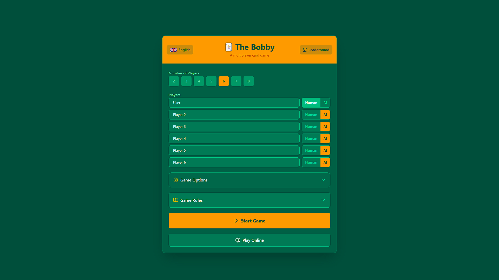
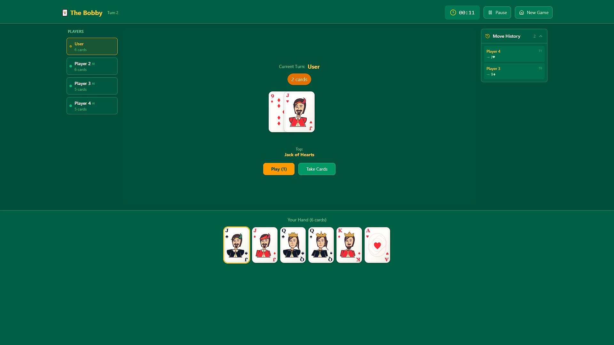
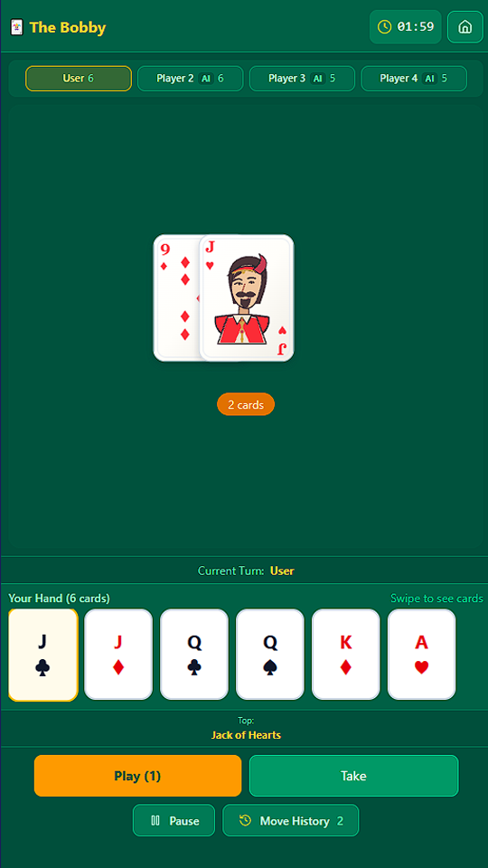
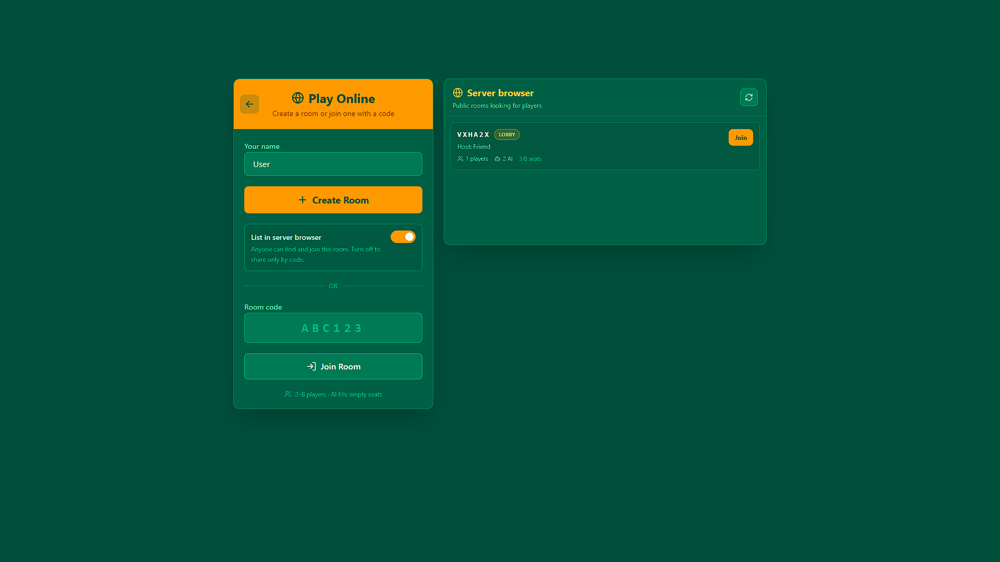

# Bobby

Bobby is a multiplayer shedding card game for 2–8 players. Be the first to discard all cards from your hand; the last player with cards loses.

Play locally in hot-seat mode or online in shared rooms with friends, spectators, and AI-filled seats.

## Screenshots






## Features

- Local hot-seat play for 2–8 players
- Online rooms with create/join by code
- Public server browser for opt-in room listing
- Spectator support
- AI opponents with Easy, Medium, Hard, and Expert difficulties
- Adaptive AI based on recorded results
- House rules for special 9s, take-all, and four-of-a-kind
- Ranked seating and random seating options
- Final rankings, including forfeited or disconnected players
- English and Lithuanian localization
- Local leaderboard

## Tech stack

- React 18
- Vite
- TypeScript
- Tailwind CSS
- Vitest
- Cloudflare Workers and Durable Objects via PartyServer

## Getting started

### Prerequisites

- Node.js
- pnpm

### Install dependencies

```bash
pnpm install
```

### Run the frontend

```bash
pnpm dev
```

Open [http://localhost:5173](http://localhost:5173) in your browser.

### Run the realtime room server

For online play, start the Cloudflare Worker locally:

```bash
pnpm party:dev
```

Then configure the frontend to use it:

```bash
VITE_ROOMS_HOST=localhost:1999 pnpm dev
```

## Online play

Online rooms support:

- Creating a private or public room
- Joining an existing room by code
- Browsing public rooms in the server browser
- Spectating games in progress
- Filling empty seats with AI
- Reconnecting after a temporary disconnect

Room listings are refreshed automatically and stale entries expire after missed heartbeats.

## Quality checks

```bash
pnpm test
pnpm i18n:check
pnpm exec tsc --noEmit
pnpm build
```

## Deployment

Deploy the realtime room server:

```bash
pnpm party:deploy
```

Deploy the frontend using your preferred static hosting provider. Make sure `VITE_ROOMS_HOST` points to the deployed room server.

## Project structure

```text
components/   React UI components
utils/        Game logic, AI, settings, leaderboard, and helpers
party/        Cloudflare Worker and Durable Objects
locales/      English and Lithuanian translations
types/        Shared TypeScript types
docs/         Documentation assets
```

## Game rules

Bobby uses cards from 9 through Ace. The 9 of Diamonds starts the pile and never leaves it. On your turn, play a card equal to or higher than the top card, or take cards from the pile if you cannot play. The first player to empty their hand wins.

Additional rules include:

- Special 9s
- Four of a kind
- Taking all cards
- Ranked seating for rematches

## License

This project is private. Add a license here if you plan to distribute it.
